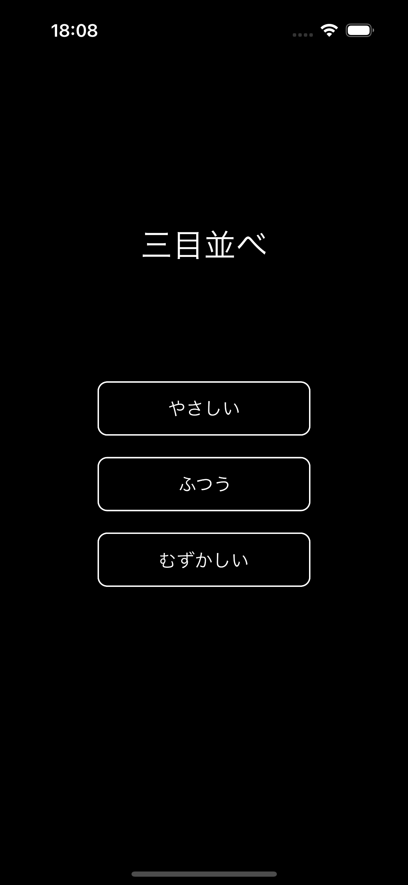
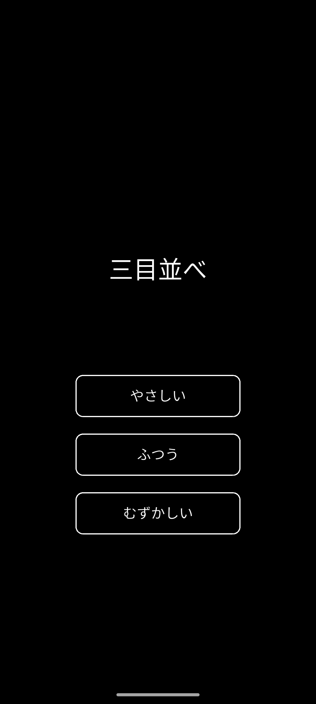
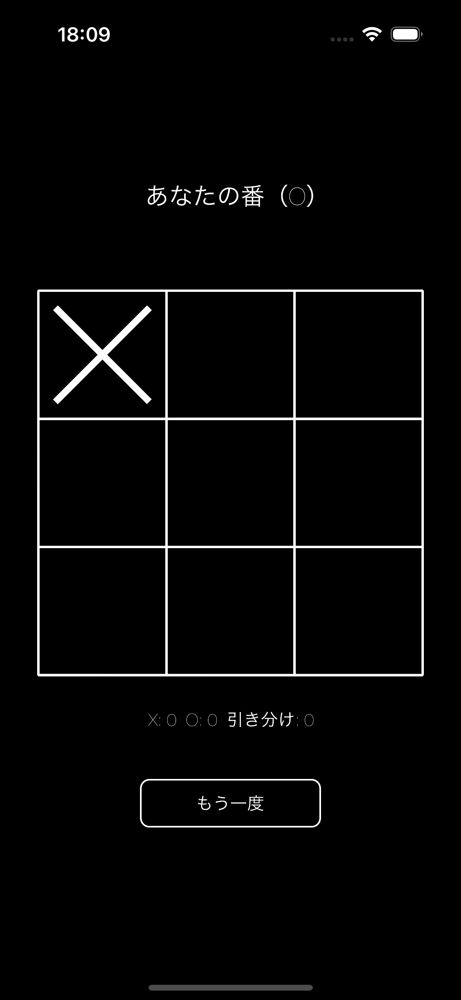
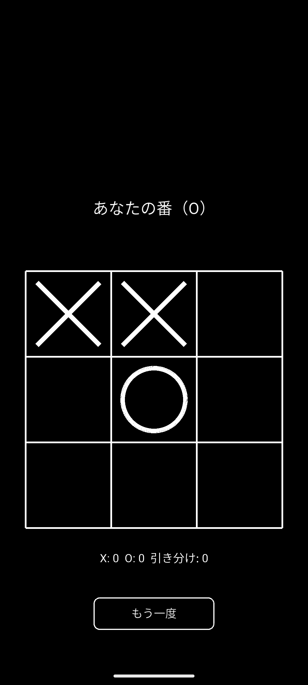

# Tic-Tac-Toe

Tic-Tac-Toe, implemented twice — once natively on iOS with Apple's own
[SpriteKit](https://developer.apple.com/documentation/spritekit) and
[GameplayKit](https://developer.apple.com/documentation/gameplaykit), and once on Android with
[bitzgroup/SpriteKit](https://github.com/bitzgroup/SpriteKit),
[bitzgroup/GameplayKit](https://github.com/bitzgroup/GameplayKit), and
[bitzgroup/GKSKBridge](https://github.com/bitzgroup/GKSKBridge) — Kotlin ports of those same two
Apple frameworks, plus the bridging surface between them.

The point isn't the game — it's the comparison. Both apps follow one shared design
([`docs/GAME_DESIGN.md`](docs/GAME_DESIGN.md)) down to the same scene graph shapes, the same
`GKGameModel`/`GKMinmaxStrategist`/`GKMonteCarloStrategist`-driven AI, and the same
`GKStateMachine` turn flow, so putting the two apps side by side is a direct demonstration that the
Android ports behave like the real, official frameworks they mirror.

Both apps' UI is localized — base language English, with a full Japanese localization — while this
repo's own documentation stays English-only, as is conventional for public OSS. See
[`docs/GAME_DESIGN.md`](docs/GAME_DESIGN.md)'s "Localization" section for details.

## Screenshots

Same layout, same grid, same win/loss/draw logic, same AI — side by side, on Apple's real
SpriteKit + GameplayKit and their Kotlin/Android ports.

<table>
<tr><th></th><th>iOS</th><th>Android</th></tr>
<tr>
<td><strong>Menu</strong></td>
<td></td>
<td></td>
</tr>
<tr>
<td><strong>Gameplay</strong></td>
<td></td>
<td></td>
</tr>
</table>

## Status

Both apps are feature-complete (`v0.1.0`) and verified playable start-to-finish at all three
difficulties, on simulators/emulators and physical devices. Since then, this repo has mainly served
as the parity harness for the three Android libraries: it records Apple's real SpriteKit/GameplayKit
behavior as parity probes (`apple-platforms/`'s `SpriteKitParity`/`GameplayKitParity` schemes) and
checks the Android ports against them. See [`docs/ROADMAP.md`](docs/ROADMAP.md) for the full plan
and history.

## Repository layout

```text
tic-tac-toe/
├── docs/          # game design, architecture, and roadmap — read these first
├── apple-platforms/  # Swift app — Apple's official SpriteKit + GameplayKit, plus SpriteKit/GameplayKit parity probes
└── android/       # Kotlin app — bitzgroup/SpriteKit + GameplayKit + GKSKBridge as git submodules
```

- [`docs/GAME_DESIGN.md`](docs/GAME_DESIGN.md) — the one game spec (rules, AI, presentation) both
  apps implement
- [`docs/ARCHITECTURE.md`](docs/ARCHITECTURE.md) — repository/project layout, how the Android app
  embeds the three library submodules, how parity is verified
- [`docs/ROADMAP.md`](docs/ROADMAP.md) — phased implementation plan and progress checklist

## Building and running

Clone with the three Android library submodules:

```sh
git clone --recurse-submodules https://github.com/bitzgroup/tic-tac-toe.git
# or, in an existing clone:
git submodule update --init --recursive
```

**iOS / Apple platforms** (from `apple-platforms/`; needs Xcode, iOS 15+ / tvOS 17+ targets).
[XcodeGen](https://github.com/yonaskolb/XcodeGen) is only needed if you add or remove files —
the generated `TicTacToe.xcodeproj` is committed.

```sh
xcodegen generate   # only after adding/removing files
xcodebuild -project TicTacToe.xcodeproj -scheme TicTacToe \
  -destination 'platform=iOS Simulator,name=<simulator>' build
xcodebuild test -project TicTacToe.xcodeproj -scheme TicTacToe \
  -destination 'platform=iOS Simulator,name=<simulator>'
```

Or open `TicTacToe.xcodeproj` in Xcode and run the `TicTacToe` scheme.

**Android** (from `android/`; needs JDK 17 and the Android SDK, min SDK 24):

```sh
./gradlew :app:assembleDebug
./gradlew :app:testDebugUnitTest
./gradlew :app:ktlintCheck :app:detekt
```

Keep the `:app` prefix: an unscoped task also runs against the included library submodules, whose
build scripts don't resolve their own config paths correctly from this repo's root.

See [`CONTRIBUTING.md`](CONTRIBUTING.md) before opening a pull request.

## License

MIT — see [`LICENSE`](LICENSE).
